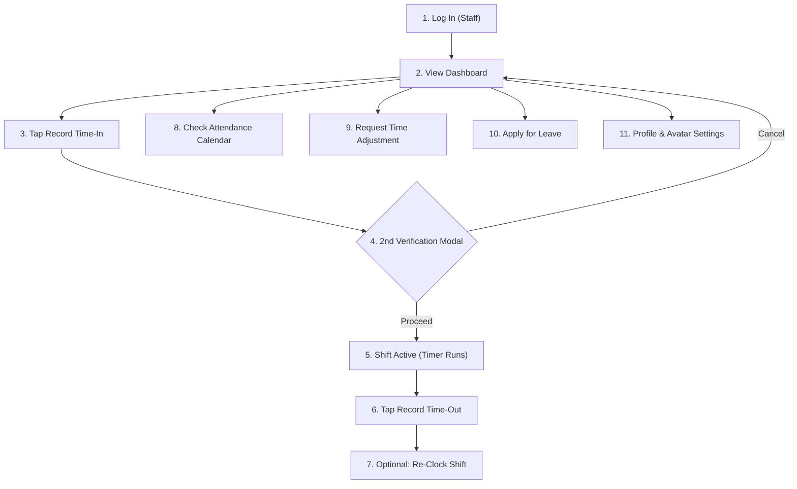
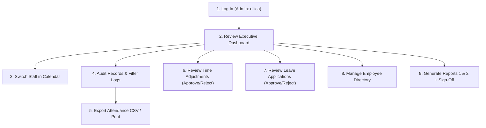

# AttendEase Enterprise — Comprehensive System Testing & User Walkthrough Guide
**Document Version:** 2.0 • **Project:** Employee Attendance Management System  
**Prepared For:** Project Defense, Quality Assurance, & Team Testing

---

## 🎯 Document Purpose
This guide is prepared for all group members (**Ellica, Herzsel, Rafael, Neil, Michael, Diether, and Clark**) to systematically test, verify, and demonstrate every feature, button, workflow, and role in the system.

Follow the step-by-step test scenarios below to ensure that every function is working as expected prior to final defense and project submission.

---

## 🌐 1. System Access & User Accounts

### System URLs
* **Frontend Application:** [http://127.0.0.1:5173](http://127.0.0.1:5173)
* **Backend REST API:** [http://localhost:5000/api](http://localhost:5000/api)

### Verified Team Test Credentials
Every group member has an active account pre-loaded in the system:

| Name | Role | Username | Password | Assigned Position & Department |
| :--- | :---: | :---: | :---: | :--- |
| **Ellica Chris Onggoco** | **Admin / Leader** | `ellica` | `admin123` | Project Director & System Administrator (EXEC) |
| **John Herzsel Datul** | **Staff** | `herzsel` | `employee123` | Lead Systems Architect & Full-Stack Engineer (IT) |
| **John Rafael Corpuz** | **Staff** | `rafael` | `employee123` | Systems Analyst & Database Engineer (IT) |
| **Neil Chester Mari Garcia** | **Staff** | `neil` | `employee123` | Frontend Engineer & UI/UX Specialist (IT) |
| **John Michael Nolasco** | **Staff** | `michael` | `employee123` | Operations & Quality Assurance Lead (OPS) |
| **Diether Baculpo** | **Staff** | `diether` | `employee123` | HR & Personnel Compliance Specialist (HR) |
| **Clark Manlapaz** | **Staff** | `clark` | `employee123` | Financial Operations & Analytics Specialist (FIN) |

> [!TIP]
> To test Admin capabilities, log in as **`ellica`** (`admin123`).  
> To test Employee/Staff capabilities, log in as **`herzsel`** (`employee123`) or any other member.

---

## ⚙️ 2. Philippine Labor Code Shift & Punctuality Rules
The system enforces Philippine Department of Labor and Employment (DOLE) compliant shift rules:

| Daily Logged Duration | System Badge & Status | Audit & Payroll Credit |
| :--- | :---: | :--- |
| **7.5 hours or more** | `Present (Whole Day)` *(Green)* | Full 1.0 workday credited. |
| **Past 9:15 AM arrival** | `Late Arrival` *(Amber)* | Flagged with exact late minutes counter. |
| **4.0 to < 7.5 hours** | `Half-Day (4h+)` *(Blue)* | Credited as 0.5 workday. |
| **1.0 to < 4.0 hours** | `Undertime (<4h)` *(Orange)* | Flagged as undertime; not credited as full day. |
| **Less than 1.0 hour** *(e.g. 1-min test)* | `Incomplete Shift (<1h)` *(Rose)* | Flagged as invalid punch / incomplete shift. |
| **Saturday & Sunday** | `Rest Day` *(Slate + Coffee Icon)* | Official non-working rest day. |
| **Official Public Holidays** | `Official Holiday` *(Gold Banner)* | Paid regular / special non-working holiday. |

---

## 🧪 3. Step-by-Step Testing Walkthrough by Role

### SCENARIO A: Staff Member Testing Walkthrough
*(Log in as `herzsel` / `employee123`)*

#### Step 1: Login & Staff Dashboard
1. Open [http://127.0.0.1:5173](http://127.0.0.1:5173).
2. Enter username `herzsel` and password `employee123`.
3. Check your Dashboard:
   - **Shift Schedule Card:** Standard 09:00 AM – 05:00 PM.
   - **Days Present:** Monthly accumulated workdays.
   - **Shift Deviations:** Grace period audit.
   - **Leave Balance:** Available vacation/sick leave credits.

#### Step 2: Time Clock Recording & 2nd Verification
1. Notice the prominent dark obsidian Time Clock widget with live Philippine Standard Time.
2. Click the large green **"Record Time-In"** button.
3. Notice the **2nd Verification Confirmation Modal**:
   - Allows you to review your timestamp before submitting.
   - Test clicking **"Cancel, Go Back"** — verifies that accidental clicks can be dismissed safely.
   - Click **"Confirm & Clock-In"** — your punch will be recorded immediately.
4. Once clocked in, the button switches to amber/red **"Record Time-Out"** with a glowing active shift pulse.
5. Click **"Record Time-Out"** $\rightarrow$ Confirm on the modal $\rightarrow$ Your shift will be finalized with logged hours.
6. Notice the **"Re-Clock Shift"** button: Click this if you want to reset your shift today to test or demo again.

#### Step 3: Attendance Calendar (Holidays & Rest Days)
1. In the sidebar or top bar, click **"My Attendance"** (or click **"Calendar"** from the Dashboard).
2. Verify the following on your calendar:
   - **Rest Days:** Saturdays and Sundays have soft slate backgrounds and a `☕ Rest Day` tag.
   - **Holidays:** Official Philippine holidays (e.g., Oct 31 Special Non-Working Day, Nov 1 All Saints' Day) display gold `🌟 Holiday` banners.
   - **Punctuality Badges:** All previous workdays show green `Present (Whole Day)` or `Late Arrival`.
   - **Monthly Counters Bar:** Whole Day, Late, Half-Day, Undertime, Incomplete, Absent, Rest Days, and Holidays counters are clearly visible.

#### Step 4: Requesting a Time Adjustment (Correction)
1. If you forgot to clock in or had a system error, click **"Request Time Adjustment"** from the Dashboard or Time Clock widget.
2. The modal will pop up:
   - Select the date of discrepancy (e.g. yesterday).
   - Enter your requested Time-In (e.g. `08:50 AM`) and Time-Out (e.g. `05:05 PM`).
   - Fill in the reason (e.g. *"Forgot to clock in due to building network connectivity delay"*).
   - Click **"Submit Request"**.
3. Go to the **"My Adjustment Requests"** tab to see your request marked with a `Pending` badge awaiting Admin approval.

#### Step 5: Applying for a Leave of Absence
1. From the Dashboard, find the **Leave Balance card** and click **"Apply for Leave →"** (or go to **"My Leave Requests"** in the sidebar).
2. Choose leave type: *Vacation Leave*, *Sick Leave*, *Emergency Leave*, etc.
3. Select start date and end date (e.g. 3 days next week).
4. Enter your reason and click **"Submit Request"**.
5. Verify that your application appears under `Pending Requests`.

#### Step 6: Profile & Security Settings
1. Click your name/avatar at the bottom of the sidebar.
2. In **My Profile**, test uploading a picture from your computer (it uses instant client-side canvas compression and syncs across your account).
3. Test the **Security & Password** tab to verify password change requirements.

---

### SCENARIO B: Administrator Walkthrough
*(Log in as `ellica` / `admin123`)*

#### Step 1: Executive Dashboard Review
1. Log in as `ellica` with password `admin123`.
2. Notice the institutional dashboard:
   - **Total Workforce:** 7 verified members.
   - **Present Today & Late Today counters.**
   - **Attendance Compliance Bar:** Percentage of checked-in staff versus active roster.
   - **Department Distribution Chart:** Staff allocation across Executive, IT, HR, Operations, and Finance.

#### Step 2: Multi-Employee Calendar Audit
1. Go to **"Attendance Records"** $\rightarrow$ **"Attendance Calendar"** tab.
2. Notice the **"Viewing Staff"** dropdown selector in the top bar.
3. Switch between **John Herzsel Datul**, **John Rafael Corpuz**, **Neil Garcia**, etc.
4. Notice how the calendar dynamically loads and audits that specific employee's whole-day punches, rest days, and approved leaves without cross-polluting data!

#### Step 3: Auditing Logs, Filtering, & CSV Export
1. Click the **"Attendance Audit Records"** (Table) tab.
2. Test the filters:
   - Filter by **Department: Information Technology**.
   - Filter by **Status: Late** or **Half-Day**.
   - Pick a specific date.
   - Clear filters with one click.
3. Test the **"Export CSV"** button:
   - Click **"Export CSV"** $\rightarrow$ browser downloads an Excel-compatible `.csv` file with BOM encoding.
4. Test the **"Print Records"** button $\rightarrow$ opens print preview with clean formatting.
5. Test **"Log Manual Record"**:
   - Click **"Log Manual Record"** $\rightarrow$ select an employee $\rightarrow$ assign a date, time in/out, and status $\rightarrow$ submit.
   - Verify that the new record immediately shows up in the table!

#### Step 4: Approving Staff Time Adjustments
1. Click the **"Time Adjustment Requests"** tab.
2. Notice the pending adjustment submitted by Herzsel (or your test staff).
3. Click **"Approve"**:
   - An approval modal opens allowing you to type optional review notes (e.g. *"Approved based on entrance turnstile log"*).
   - Click **"Confirm Decision"**.
4. Notice the status turns green **Approved**, and the employee's official attendance record is automatically reconciled!

#### Step 5: Approving Leave Applications
1. In the sidebar, navigate to **"Leave Requests"**.
2. Notice the pending leave application submitted earlier.
3. Click **"Approve"** (or **"Reject"**):
   - Enter supervisory review notes (e.g. *"Approved by Management. Have a great vacation!"*).
   - Click **"Confirm Decision"**.
4. Once approved, the leave automatically syncs to the employee's Attendance Calendar as an approved leave block!
5. Click **"Export CSV"** to download all leave records.

#### Step 6: Employee Directory & Department Management
1. Go to **"Employee Directory"**:
   - View all 7 members, their contact info, positions, and shifts.
   - Click **"View Details"** on any member to open their complete profile drawer.
   - Test **"Export Roster (CSV)"** to download the official staff list.
   - Click **"Add New Employee"** to test staff onboarding.
2. Go to **"Departments"**:
   - Check the 5 departments (Executive, IT, HR, Operations, Finance), their assigned heads, and operational budgets.
   - Test adding or editing a department.

#### Step 7: Reports, Compliance, & Academic Sign-off
1. Navigate to **"Reports & Analytics"**.
2. **Report 1: Monthly Attendance Summary**:
   - Breakdown per employee: Days worked, on-time arrivals, late minutes, hours logged, and compliance rating.
   - Click **"Export CSV"** to download Report 1 as a spreadsheet.
3. **Report 2: Department Cross-Analytics**:
   - Click the **"Report 2: Department Cross-Analytics"** sub-tab.
   - Compares total hours worked, punctuality rates, and approved vs pending leaves across all 5 departments.
   - Click **"Export CSV"** to download Report 2.
4. **Print Official Report**:
   - Click **"Print Official Report"** (or press `Ctrl+P`).
   - Notice the formal institutional header, metadata, and the **academic evaluation sign-off block** for:
     1. Ellica Chris Onggoco *(Group Leader & System Admin)*
     2. John Herzsel Datul *(Lead Systems Architect)*
     3. Project Evaluator / Instructor

---

## ✅ 4. Team Testing Verification Checklist
Print or share this checklist with the team so everyone can verify their assigned module:

- [ ] **1. Authentication:** Successfully logged in as Admin (`ellica`) and Staff (`herzsel`).
- [ ] **2. 2nd Verification Modal:** Tested clicking "Cancel" and "Confirm" on Time-In / Time-Out.
- [ ] **3. Re-Clock Feature:** Reset today's shift to test punch sequences again.
- [ ] **4. Labor Code Statuses:** Verified Whole Day ($\ge 7.5\text{h}$), Late, Half-Day, Undertime, and Incomplete ($<1\text{h}$) badges.
- [ ] **5. Calendar Rest Days & Holidays:** Verified Saturdays/Sundays as `Rest Day` and holidays with Gold badges.
- [ ] **6. Table-Calendar Decoupling:** Filtered for "Late" in logs; verified that "Present" days in the Calendar remained intact.
- [ ] **7. Time Adjustment Request:** Staff filed request $\rightarrow$ Admin approved $\rightarrow$ record synced.
- [ ] **8. Leave Request Workflow:** Staff applied $\rightarrow$ Admin approved $\rightarrow$ calendar updated.
- [ ] **9. Data Exports:** Tested clicking "Export CSV" on Attendance, Reports, Directory, and Leaves.
- [ ] **10. Official Print:** Tested "Print Official Report" with evaluation signature lines.
- [ ] **11. Profile & Avatar:** Uploaded photo with instant compression and updated account settings.
- [ ] **12. Zero Console Errors:** Verified smooth operation with 0 frontend or backend crashes.

---
*AttendEase Enterprise • Developed for Academic Evaluation & Enterprise Deployment*
